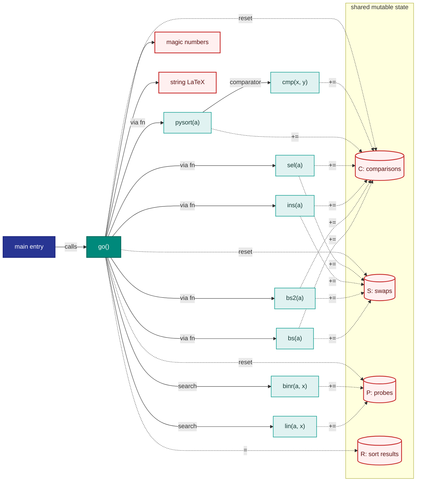
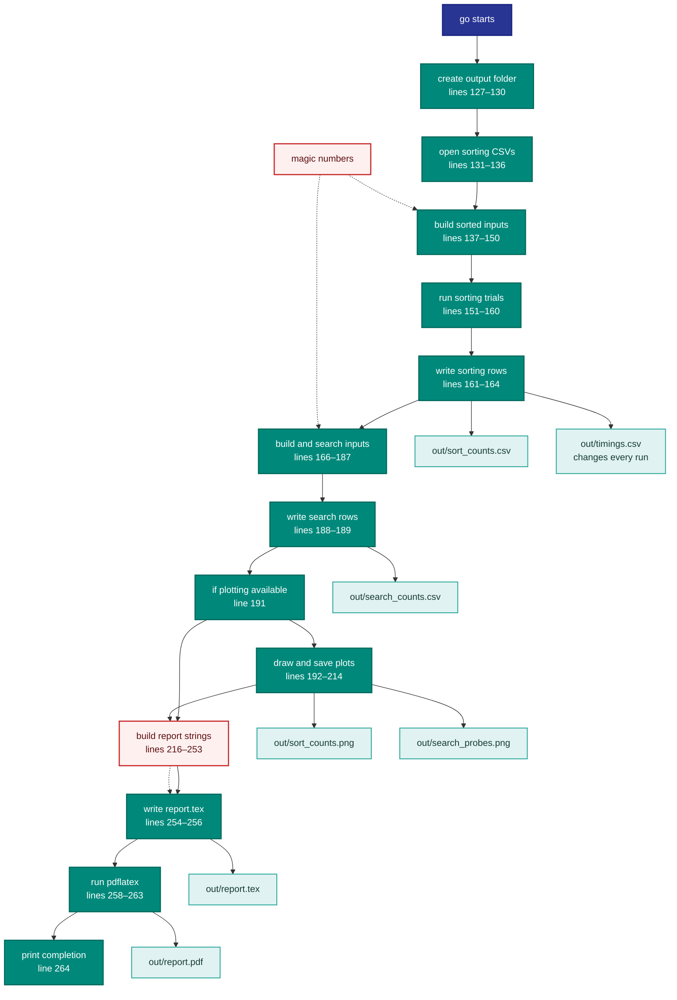

# Before Map: `beast.py` As It Is

Line references are to the current `beast.py`.

## Diagram A — Who calls whom, and what they share

### Diagram A smells

- `C`, `S`, `P`, and `R` are shared mutable globals declared at lines 14–17.
- `bs` and `bs2` repeat nested bubble-sort loops, with early exit only in `bs2` (lines 25–53).
- The sizes, trial count, lookup count, and input range are fixed numeric values (lines 18–20, 146, 172, and 178).
- `go()` builds LaTeX by concatenating strings across lines 216–253.

## Diagram B — What `go()` does, in order

### Diagram B smells

- Fixed sizes and counts, plus numeric input-range values, appear at lines 18–20, 146, 172, and 178.
- `go()` assembles the LaTeX document through string concatenation at lines 216–253.

### Unverified

- `pdflatex` is invoked at lines 258–260 with `-output-directory out`; the exact PDF filename and any auxiliary files depend on the installed `pdflatex` behavior. The PDF node represents the expected `out/report.pdf` output, not a verified artifact.
